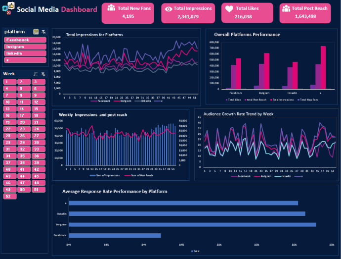
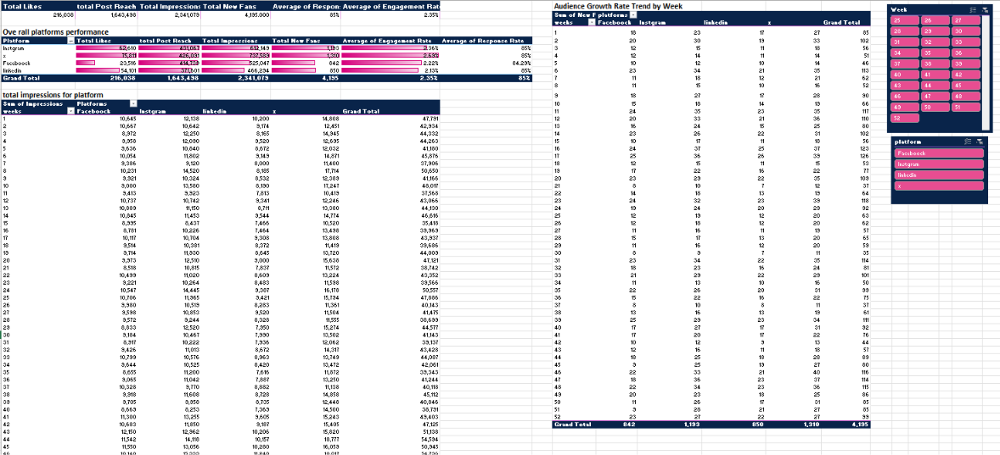

#  Social Media Performance Dashboard

**Excel dashboard tracking engagement, reach, and audience growth across Facebook, Instagram, LinkedIn, and X**

An interactive Excel dashboard that compares four social media platforms over **52 weeks** using impressions, post reach, likes, new fans, engagement rate, and response rate, so a marketing team can see which platform performs best and how performance moves week by week.



---

##  Table of Contents
- [Business Problem](#-business-problem)
- [Tools & Technologies](#-tools--technologies)
- [Project Workflow](#-project-workflow)
- [Dashboard](#-dashboard)
- [KPIs](#-kpis)
- [Key Insights](#-key-insights)
- [Skills Demonstrated](#-skills-demonstrated)
- [Repository Structure](#-repository-structure)

---

##  Business Problem
A marketing team runs four social media channels and needs one view to answer:
- Which platform delivers the most impressions, reach, likes, and new fans?
- How engaged and responsive is the audience on each platform?
- How do impressions, reach, and audience growth change week by week?

---

##  Tools & Technologies
| Layer | Tool |
|---|---|
| Analysis | Excel Pivot Tables |
| Visualization | Excel charts, data bars, KPI cards |
| Interactivity | Slicers (Platform, Week) |

---

##  Project Workflow
1. **Prepared the weekly data** for the four platforms (Facebook, Instagram, LinkedIn, X) across 52 weeks.
2. **Built pivot tables** for the KPIs, the overall platform comparison (likes, reach, impressions, new fans, engagement rate, response rate), weekly impressions per platform, and weekly new fans per platform.
3. **Designed the dashboard:** four KPI cards, five charts, and two slicers (Platform and Week), styled with a consistent dark navy and pink theme.



---

##  Dashboard
| Visual | What it shows |
|---|---|
| KPI cards | Total New Fans, Total Impressions, Total Likes, Total Post Reach |
| Total Impressions for Platforms | Weekly impressions trend for each platform |
| Overall Platforms Performance | Likes, post reach, impressions, and new fans side by side per platform |
| Weekly Impressions and Post Reach | Weekly volume (columns) against reach (line) |
| Audience Growth Rate Trend by Week | New fans per week for each platform |
| Average Response Rate by Platform | Response rate comparison |

Slicers for **Platform** and **Week** filter every visual.

---

##  KPIs
| KPI | Value |
|---|---|
| Total Impressions | 2,341,079 |
| Total Post Reach | 1,643,498 |
| Total Likes | 216,038 |
| Total New Fans | 4,195 |
| Average Engagement Rate | 2.35% |
| Average Response Rate | 85% |

### Platform comparison
| Platform | Impressions | Likes | New Fans |
|---|---|---|---|
| X | 737,589 | 75,811 | 1,310 |
| Instagram | 612,149 | 62,610 | 1,193 |
| Facebook | 525,047 | 23,516 | 842 |
| LinkedIn | 466,294 | 54,101 | 850 |

---

##  Key Insights
1. **X is the strongest platform.** It leads in impressions (31% of the total), likes (35%), and new fans (31%), and has the highest engagement rate (about 2.6%).
2. **Facebook converts impressions into likes poorly.** It gets 525K impressions (22% of the total) but only 23.5K likes, about 4.5 likes per 100 impressions, compared with 10 to 12 on the other three platforms.
3. **LinkedIn is small but efficient.** It has the fewest impressions but the best like rate (about 11.6 likes per 100 impressions) and similar audience growth to Facebook.
4. **Response rate is almost identical across platforms (about 85%).** Facebook is slightly lower at 84.2%, so response speed is not what separates the platforms.
5. **Post reach equals about 70% of impressions** (1.64M reach from 2.34M impressions), which means each reached user saw the content about 1.4 times on average.

---

##  Skills Demonstrated
`Excel` • `Pivot Tables` • `Slicers` • `KPI Design` • `Data Visualization` • `Dashboard Design` • `Marketing Analytics` • `Data Analysis`

---

##  Repository Structure
```
social-media-dashboard-excel/
├── README.md
├── Social_Media_Dashboard.xlsx   
└── images/
    ├── 01-dashboard.png
    └── 02-pivot-tables.png
```

---

##  How to Use
1. Download `Social_Media_Dashboard.xlsx` and open it in Excel.
2. Go to the dashboard sheet and use the **Platform** and **Week** slicers to filter every chart.
3. The pivot tables sheet shows how each number was calculated.


